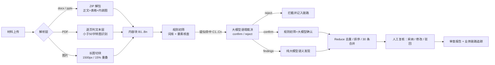

# 小保 · 金融营销宣传消保智能审查

一个面向银行消保（消费者权益保护）事前审查场景的智能审查 Demo：把「规则初筛 → 大模型语境裁决 → 人工复核」串成一条可追溯的完整链路，输出带法规条款、判断路径与来源定位的可复核意见。

**在线体验：** <https://consumer-review.app.workbuddy.host/?sharecode=DVJGPNLACX>（无需登录）

---

## 1. 要解决什么问题

银行员工不得自行编发未经审查的金融营销宣传材料。现实中这一环节高度依赖人工逐字阅读：

- 一个条线一次活动就可能几十份海报、短信、折页、话术；
- 判断标准依赖审查人员经验，同一句话不同人结论不同；
- 出了问题倒查时，说不清"当时是按哪条法规、哪个原文片段判的"。

小保要做的不是"替人下结论"，而是**把每一份材料过一遍机器初审，把可疑点连原文、连法条、连判断依据一起摆到审查人员面前**，人只做判断题。

## 2. 它跑起来是什么样

四个阶段，对应四类角色：

| 阶段 | 角色 | 动作 |
|---|---|---|
| ① 发起审查 | 业务部门 | 选择条线/材料类型，上传材料或粘贴文本 |
| ② 智能审查 | 系统 | 解析 → 规则初筛 → 大模型语境裁决 → 生成意见 |
| ③ 人工复核 | 消保人员 | 逐条采纳 / 修改 / 驳回，可撤回、撤销、回退 |
| ④ 审查完结 | 系统 | 生成报告、归档、业务链路追踪、推送业务部门 |

## 3. 三个核心设计

### 3.1 规则只做初筛，大模型拥有否决权

规则命中不再直接成为意见。规则层产出的是**候选**（C1、C2…），连同原文一起送进大模型，由模型逐条裁决：

```json
"rule_verdicts": [
  { "candidate_id": "C1", "verdict": "reject",
    "reason": "最高+数字单位修饰贷款额度，属定量业务参数上限" }
]
```

| 裁决 | 结果 | 卡片来源标签 |
|---|---|---|
| confirm | 采用模型的理由/法条/建议，可升降风险等级 | 规则初筛+大模型确认 |
| reject | 不进意见清单，记入「已拦截规则误报」 | — |
| findings | 模型自己发现的语义问题 | 纯大模型语义发现 |

模型漏裁的候选不会静默丢失，保留但降为「待确认」；模型不可用时退回规则命中并标注「未经大模型确认」。

### 3.2 维度五：区分「定量上限」与「绝对化用语」

这是最容易误报的一类。《广告法》第九条第（三）项禁止的是**无法量化验证**的绝对化表述，而不是产品参数上限。

| 原文 | 判定 | 依据 |
|---|---|---|
| 单人最高**贷150万元** | 合规 | 最高 + 参数名词/数字 = 定量上限 |
| 金额**最高30万** | 合规 | 同上 |
| 授信**最长36个月** | 合规 | 同上 |
| **收益最高**5.8% | 违规 | 谓词位置，「收益+最高」= 绝对化 |
| **最高级**配置 / **全行唯一** | 违规 | 等级、排他性表述 |

实现上是一个守卫函数，而不是继续堆正则：

```js
// 谓词位置不豁免：收益/回报/涨幅 + 最高
if (/(收益|回报|涨幅|业绩|分红|排名)\s*$/.test(before)) return false;
// 等级用语不豁免
if (/^级/.test(after)) return false;
// 后接参数名词或数字 → 定量上限，豁免
if (QUANT_PARAM_AFTER.test(after)) return true;
if (/^\s*\d/.test(after)) return true;
```

### 3.3 维度二：三个特征门，缺一不判

禁止的是「引用不真实数据」或「隐瞒限制条件进行夸大」，而不是"见到数字就报"。命中任一特征才成立：

- **A 无源数据**：引用排名/收益，且无来源、无统计口径、无时间标记 → 中
- **B 隐瞒限制**：把业绩基准/分红演示说成确定收益，或只给极端收益（≥30%）且全文无风险提示 → 高
- **C 绝对保证**：数据周围出现「稳赚/必得/保证/100%正收益」→ 高

明确的合规豁免：带时间标记的客观历史数据（*2025年收益11.99%*、*成立以来4%*）、产品要素说明（*量化对冲策略*、*权益仓位约20%*、*纯信用免担保*）、模糊定性描述（*回撤相对较小*，最多给 1 条低风险建议）。

## 4. 审查维度

对齐《银行保险机构消费者权益保护管理办法》第二十三条七类禁止行为，外加一条「特别标识显著性」：

| 维度 | 内容 | 法规锚点 |
|---|---|---|
| 一 | 虚假、欺诈、隐瞒或引人误解的宣传 | 第二十三条第（一）项 |
| 二 | 数据不实、隐瞒限制条件、夸大业绩 | 第二十三条第（二）项 |
| 三 | 利用监管审核/备案程序误导 | 第二十三条第（三）项 |
| 四 | 保本、无风险、保收益承诺 | 第二十三条第（四）项 |
| 五 | 「国家级」「最高级」「最佳」「唯一」等极限用语 | 《广告法》第九条第（三）项 |
| 六 | 性别、种族、宗教信仰等歧视性用语 | 第二十三条第（六）项 |
| 七 | 其他违规与适当性侵犯 | 《消保法》第十条 |
| 八 | 限制消费者权利事项缺乏显著标识、风险揭示不足 | 第二十一条 |

## 5. 架构



## 6. 工程要点

**解析能力**

- docx：ZIP 直解，取正文 + 表格数 + `word/media/` 内嵌图片逐张视觉识别；EMF/WMF 标为矢量图需人工复核
- PDF：逐页判断文本层，单页 < 50 字视为扫描页 → 渲染 2000px 宽转图片识别；每 5 页一批，扫描页上限 30 页；文字页与扫描页可混合
- 长图：长边 > 2000px 自动切块（1500px/块、15% 重叠），重叠文本去重，避免切缝丢小字
- pptx：只读 `ppt/slides/`，天然排除母版/版式/备注；图表与 SmartArt 无法抽字 → 生成人工复核提示

**审查流水线**

- 块级 Map：每块规则 + 大模型独立审查，单块上限 8 条
- 全局 Reduce：跨块去重 → 风险排序 → 30 条上限，超出按同维度合并并注明
- 单屏展示 20 条，完整报告以导出为准
- 引用校验：模型给出的原文片段必须能在材料中检索到，否则剔除并计数

**人机协同状态**

- 单条撤回、全局撤销/重做（≤10 步，Ctrl+Z / ⌘+Z）
- 步骤条回退：③→② 重置复核状态；②→① 可选「清空」或「保留材料」
- 完结后「再次发起审查」、最近 3 次历史摘要
- 业务链路追踪：从上传到归档的每个节点（含回退、撤回、误报拦截）均可导出

## 7. 快速开始

```bash
cd app
npm start          # 默认 http://127.0.0.1:3000
```

无第三方依赖，纯 Node 内置模块；前端为原生 JS + Canvas，无构建步骤。

云服务（免密钥大模型调用）通过 `public/app.js` 顶部的 `CFG` 注入，部署时替换为自己环境的 `endpoint` 与 `publishableKey` 即可。

## 8. 回归基线

改动 prompt 或规则后用以下样例回归，避免"改一处坏一处"：

| 样例 | 期望 | 实测 |
|---|---|---|
| 纯合规理财文案（C / R3） | 0 条，结论通过 | ✅ 0 条 |
| 贷款上限（单人最高贷150万/夫妻共贷最高300万） | 维度五 0 条；无脚注时 1 条低风险建议，有脚注 0 条 | ✅ |
| 贷款要素（金额最高30万/授信最长36个月/纯信用免担保） | 0 条 | ✅ |
| 业绩陈述（2025年收益11.99%、量化对冲、回撤相对较小） | 0 高危，至多 1 条低风险 | ✅ |
| 真极限词（全行唯一爆款、收益最高5.8%） | 维度五高危 | ✅ |

## 9. 已知限制

- 图表、SmartArt、Office 矢量图内的文字无法自动提取，仅生成人工复核提示
- 扫描件识别率依赖视觉模型，降级到本地 OCR 时需逐字核对
- 维度二/五以外的语义判断（如内部矛盾、包装暗示）依赖模型能力，存在波动；同一输入多次运行结论可能不完全一致
- 意见上限为工程折中（每块 8 / 全局 30），超长材料需拆分
- 历史记录存于浏览器 localStorage，未落库

## 10. 目录

```
app/                 # 可运行的应用（Node 零依赖 + 原生前端）
  server.js          # 静态托管 + docx/pptx 解析 API
  public/
    index.html       # 四步工作台
    app.js           # 解析 / 分块审查 / 状态机 / 报告
    rules.js         # 规则库（四元组）+ 要素核查
    styles.css
docs/
  business-flow.drawio   # 业务流程图（draw.io 可直接打开）
  screenshots/           # 界面与来源定位截图
tests/
  gen_test_materials.py  # 生成 docx/pptx/长图/超量文本等测试材料
  sample-bulk.txt        # 31 条意见的超量样例
```

---

本项目为演示用途，材料与结论仅作技术验证，不构成合规意见。
